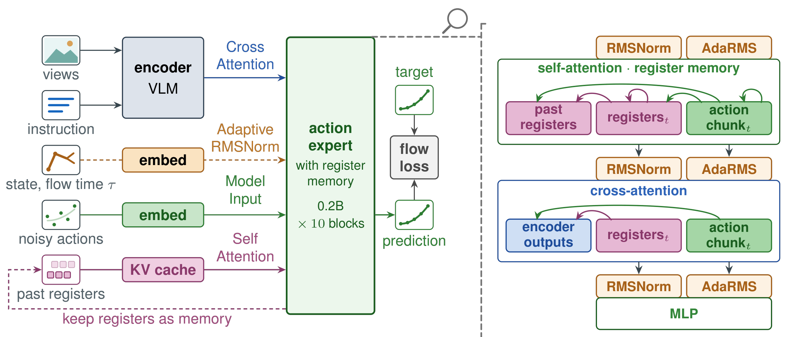
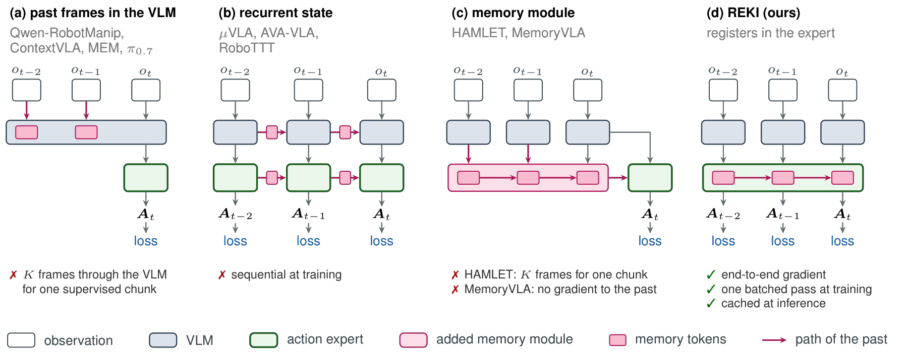
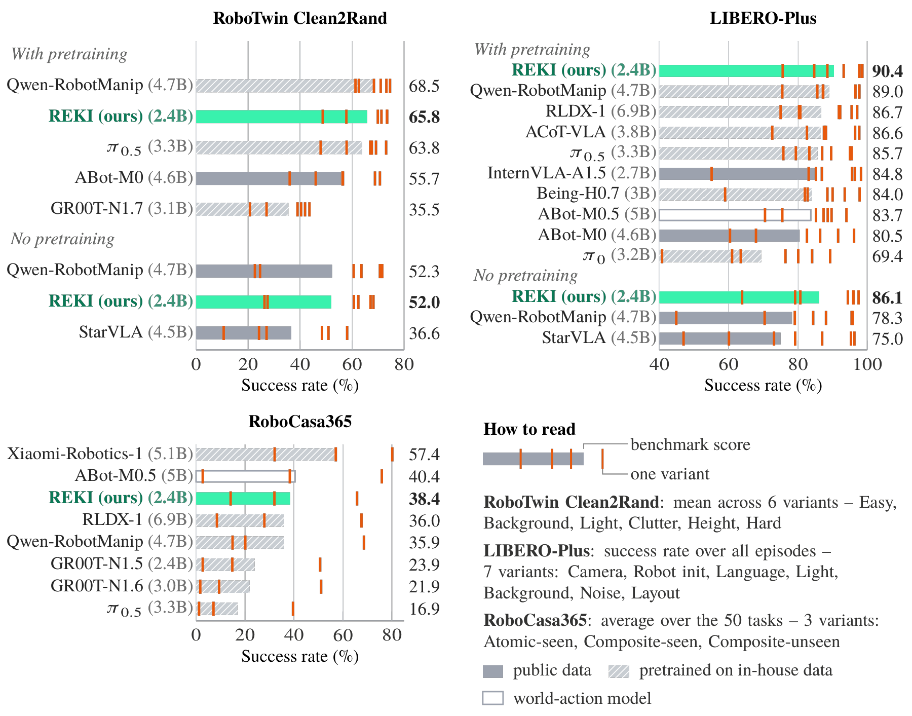

<div align="center">

# REKI: Registering Knowledge in VLAs

**A 2.4B vision-language-action model pretrained on public data only, with a memory of its recent past at negligible cost.**

[](https://arxiv.org/abs/2610.22178)
[](https://kyutai.org/reki/)
[](https://huggingface.co/collections/kyutai/reki-6ac371366b3da8cdece73ce2)
[](LICENSE)
[](https://creativecommons.org/licenses/by-nc-sa/4.0/)

<picture>
  <source media="(prefers-color-scheme: dark)" srcset="docs/assets/architecture_dark.png">
  
</picture>

</div>

## News

- **2026-10-20:** We published REKI on PyPI as `reki-vla` (`pip install reki-vla`), with
  inference support for the finetuned models. We moved from PyTorch 2.7 to 2.10 so that REKI no
  longer requires compiled CUDA extensions (`flash-attn` and `causal-conv1d`).

## Model

REKI is a vision-language-action (VLA) model. A Qwen3.5-2B VLM encodes the camera views and the
instruction of the current observation. A diffusion-transformer (DiT) action expert reads the final
VLM layer through cross-attention and predicts a 1 s action chunk with flow matching.

- **Memory at negligible cost.** The memory gives the policy access to its recent past: 32
  register tokens in the action expert summarize the output of the VLM at each frame and persist
  in the expert's cache. Reading them adds less than 1% to the time of predicting a chunk. Memory
  raises the success rate by 1.5 points on LIBERO-Plus, 5.5 on RoboTwin clean scenes and 5.4 on
  RoboCasa365, and makes oscillations between poses about four times rarer.
- **Fast inference.** With compilation, REKI predicts an action chunk in 21.8 ms on one H100 from
  two 256×256 camera images.
- **Strong out-of-distribution generalization.** Among models pretrained on public data, REKI has
  the highest scores on RoboTwin Clean2Rand (65.8) and LIBERO-Plus (90.4).
- **Public data only.** REKI is pretrained on public real-robot, simulation, human-hand and
  vision-language data, then finetuned on each benchmark.

<p align="center">
  <picture>
    <source media="(prefers-color-scheme: dark)" srcset="docs/assets/memory_mechanisms_dark.png">
    
  </picture>
</p>

| Document | Content |
|---|---|
| [docs/architecture.md](docs/architecture.md) | model architecture: VLM, action expert, register tokens, state conditioning, training samples and inference |
| [docs/training.md](docs/training.md) | configs, recipe, finetuning on your robot, export |
| [docs/data.md](docs/data.md) | pretraining mixture, state formats, normalization, adding a dataset |
| [docs/evaluation.md](docs/evaluation.md) | benchmarks, protocols, metrics, sim servers |

## Results

<p align="center">
  <picture>
    <source media="(prefers-color-scheme: dark)" srcset="docs/assets/results_bars_dark.png">
    
  </picture>
</p>

<details>
<summary>Benchmark results</summary>

Success rates (%) of the released models.

| Benchmark | REKI |
|---|---|
| LIBERO (4 suites) | 97.6 |
| LIBERO-Plus (7 perturbation axes) | 90.4 |
| RoboTwin 2.0, Easy / Hard | 85.9 / 84.6 |
| RoboTwin Clean2Rand (finetuned on clean scenes, mean of 6 conditions) | 65.8 |
| RoboCasa365 (50 target tasks) | 38.4 |

[Released models](#released-models) lists the model behind each row.

**LIBERO-Plus** (`reki-2b-libero`)

| Camera | Robot init | Language | Light | Background | Noise | Layout | Overall |
|---|---|---|---|---|---|---|---|
| 93.2 | 75.6 | 88.5 | 97.7 | 98.4 | 98.6 | 84.7 | **90.4** |

Overall is the success rate over all 10,030 perturbed episodes.

**RoboTwin Clean2Rand** (`reki-2b-robotwin-clean`, finetuned on clean scenes only)

| Easy | Background | Light | Clutter | Height | Hard | Mean |
|---|---|---|---|---|---|---|
| 73.4 | 71.3 | 73.5 | 57.8 | 69.9 | 48.7 | **65.8** |

Easy uses clean scenes. Each middle column applies one randomization, and Hard applies all four
together.

</details>

## Released models

| Model | Stage | Robot | Benchmark | Recipe | Model card |
|---|---|---|---|---|---|
| [`kyutai/reki-2b`](https://huggingface.co/kyutai/reki-2b) | Pretrained | [pretraining mixture](docs/data.md#pretraining-mixture) | — | [`cpt.yaml`](configs/cpt.yaml) | [card](https://huggingface.co/kyutai/reki-2b) |
| [`kyutai/reki-2b-libero`](https://huggingface.co/kyutai/reki-2b-libero) | Finetuned | Franka Panda | LIBERO, LIBERO-Plus | [`sft.py`](launchers/sft.py) `libero` | [card](https://huggingface.co/kyutai/reki-2b-libero) |
| [`kyutai/reki-2b-robotwin-clean`](https://huggingface.co/kyutai/reki-2b-robotwin-clean) | Finetuned | ALOHA (bimanual) | RoboTwin Clean2Rand | [`sft.py`](launchers/sft.py) `robotwin_clean` | [card](https://huggingface.co/kyutai/reki-2b-robotwin-clean) |
| [`kyutai/reki-2b-robotwin-cleanrand`](https://huggingface.co/kyutai/reki-2b-robotwin-cleanrand) | Finetuned | ALOHA (bimanual) | RoboTwin 2.0, clean + randomized scenes | [`sft_3n.py`](launchers/sft_3n.py) `robotwin_cleanrand` | [card](https://huggingface.co/kyutai/reki-2b-robotwin-cleanrand) |
| [`kyutai/reki-2b-robocasa365`](https://huggingface.co/kyutai/reki-2b-robocasa365) | Finetuned | PandaOmron (mobile) | RoboCasa365 | [`sft_4n.py`](launchers/sft_4n.py) `robocasa365` | [card](https://huggingface.co/kyutai/reki-2b-robocasa365) |

## Installation

To run the finetuned models ([Quickstart](#quickstart)), install the package from PyPI:

```bash
pip install reki-vla    # or: uv add reki-vla
```

It requires Linux x86-64, Python 3.12, an NVIDIA GPU of the Ampere generation or newer with
driver 570 or newer, a C compiler and the Python 3.12 headers.

Training, evaluation and deployment run from the repository, with [pixi](https://pixi.sh). The
pixi environment provides Python 3.12:

```bash
git clone https://github.com/kyutai-labs/reki.git
cd reki
pixi install --frozen        # default environment: training and inference
```

Each benchmark simulator has its own environment. `bash scripts/eval/install.sh <benchmark>`
installs one ([scripts/eval/SETUP.md](scripts/eval/SETUP.md)).

Put your paths in `.env` at the repository root. Git ignores this file. `pixi run` and the
Slurm jobs read it. A variable set in the shell overrides the file. On a cluster, use disks
that the compute nodes see:

```bash
cp .env.example .env   # then edit .env
```

| Variable | Meaning |
|---|---|
| `REKI_DATASETS_ROOT` | root of all LeRobot datasets (default: `storage/datasets` in the repository) |
| `REKI_RUNS_DIR` | run directories of the Slurm launchers (default: `storage/runs` in the repository) |
| `REKI_SIM_ROOT` | the benchmark simulators (default: `storage/sim` in the repository) |
| `HF_HOME` | optional: Hugging Face cache (Qwen3.5-2B, released models). The default is `~/.cache/huggingface` |
| `SBATCH_PARTITION` | optional: Slurm partition of the jobs (default: the cluster default) |

[docs/training.md](docs/training.md#slurm) lists the other cluster settings.
[`.env.example`](.env.example) lists all of them.

<details>
<summary>Version pins</summary>

`pixi.lock` pins all versions, among them `torch==2.10.0`, `transformers==5.3.0`,
`flash-linear-attention==0.4.2` and `lerobot==0.5.1`.

</details>

## Quickstart

```python
from reki import RekiPolicy

policy = RekiPolicy.from_pretrained("kyutai/reki-2b-libero", device="cuda")
policy.reset()                    # at the start of every episode: clears the register memory
actions = policy.predict(
    images={"camera_top": img0, "camera_wrist_left": img1},  # HxWx3 uint8, RGB
    state=proprio,                # training dataset's observation.state, float [policy.spec.state_dim]
    task="put the bowl on the plate",
)                                 # float32 np.ndarray [policy.n_action_steps, action_dim], unnormalized
```

- Call `predict` once every `policy.n_action_steps` environment steps (1 s for all released
  models), and execute the returned actions in between
  ([predict cadence](docs/architecture.md#inference)).
- `policy.spec.camera_keys` and `policy.spec.state_layout` give the expected cameras and the
  state order. The images must have the orientation of the training data (for LIBERO, rotate the
  env images by 180°, see [docs/evaluation.md](docs/evaluation.md#parity-rules)).

## Evaluation

[docs/evaluation.md](docs/evaluation.md) describes the benchmarks, the protocol of each reported
number and the metrics. [scripts/eval/SETUP.md](scripts/eval/SETUP.md) installs the simulators.
[`launchers/eval.py`](launchers/eval.py) evaluates the released models on Slurm.

```bash
bash scripts/eval/install.sh libero libero_plus
pixi run python launchers/eval.py table                                  # the models and their tasks
pixi run python launchers/eval.py select 0 eval submit   # reki-2b-libero: LIBERO and LIBERO-Plus
pixi run python launchers/eval.py select 0 results                       # one table per task
```

Without Slurm, `launchers/eval_protocols.py` prints the commands of one benchmark for a local
checkpoint directory:

```bash
pixi run hf download kyutai/reki-2b-libero --local-dir checkpoints/reki-2b-libero
pixi run python launchers/eval_protocols.py libero checkpoints/reki-2b-libero results/ | bash
pixi run python scripts/eval/results_table.py results/
```

The [LeRobot plugin](docs/evaluation.md#lerobot-plugin) `lerobot_policy_reki` runs every
finetuned model in LeRobot, also with `lerobot-eval` in our simulators. The pretrained
`kyutai/reki-2b` is for finetuning.

## Finetuning

[`configs/sft.yaml`](configs/sft.yaml) holds the fields that all finetuning runs share. Each
launcher adds the fields of its benchmarks:

- [`launchers/sft.py`](launchers/sft.py): LIBERO and RoboTwin clean, on one node of 8 GPUs.
- [`launchers/sft_3n.py`](launchers/sft_3n.py): RoboTwin clean + randomized, on three nodes (24 GPUs).
- [`launchers/sft_4n.py`](launchers/sft_4n.py): RoboCasa365, on four nodes (32 GPUs).

First, download the LIBERO data and compute its normalization statistics.
[docs/data.md](docs/data.md#benchmark-datasets) gives the steps for the other benchmarks.

```bash
pixi run python scripts/data/download.py libero
pixi run python scripts/data/recompute_euler_stats.py --datasets libero
```

The launchers submit to Slurm through [launcheon](https://github.com/kyutai-labs/launcheon).
Without Slurm, train with `pixi run train` ([docs/training.md](docs/training.md#run)).

```bash
pixi run python launchers/sft.py table                               # one row per benchmark
pixi run python launchers/sft.py select 0 submit                     # finetune on LIBERO (Slurm, 8 GPUs)
pixi run python launchers/sft.py select 0 eval --task libero submit  # evaluate its latest checkpoint
pixi run python launchers/sft.py select 0 results                    # success rate per checkpoint
pixi run python launchers/sft.py select 0 cmd                        # print the training command
```

[docs/training.md](docs/training.md) gives the training setup, the finetuning runs, finetuning on
your own robot and the checkpoint export.

### Train your own model

`scripts/train.py` can train another policy with the same data, sampling, schedule and optimizer.
Only the model changes.

1. Subclass `ExternalPolicy` and `ExternalDatasetPreprocessor`
   ([`reki/policy/external/base.py`](reki/policy/external/base.py) lists the methods).
2. Decorate the policy class with `@register_external` and import its module in
   [`reki/policy/external/__init__.py`](reki/policy/external/__init__.py).
3. Train with `--external_policy=<name> --history_k=1`.

- The dataset gives raw state and action, decoded RGB images and the task text. The adapter does
  its own normalization, tokenization and image resizing.
- The adapter gets one frame (`history_k: 1`) and no vision-language data.
- Datasets with a gripper flip (LIBERO) and `mirror_prob > 0` are not supported.
- [`tests/training/test_external_policy.py`](tests/training/test_external_policy.py) holds a
  minimal adapter (an MLP) that trains end to end.

## Real-robot deployment

Finetune `kyutai/reki-2b` on your robot data
([docs/training.md](docs/training.md#finetune-on-your-robot)), then serve it over the
[LeRobot async-inference](https://huggingface.co/docs/lerobot/async) gRPC protocol. The GPU
machine needs the checkpoint and the `meta/` directory of the finetuning dataset under
`REKI_DATASETS_ROOT`, or an exported checkpoint
([docs/training.md](docs/training.md#export)).

```bash
pixi run python scripts/deploy/policy_server_lerobot.py --ckpt=runs/<run>/checkpoint-N \
    --dataset=<your_dataset> --port=8080
# check the server without a robot
pixi run python scripts/deploy/lerobot_dummy_client.py --ckpt=runs/<run>/checkpoint-N \
    --dataset=<your_dataset> --server_address=127.0.0.1:8080 --cycles=3 --probe_gate=True
# on the robot
python -m lerobot.async_inference.robot_client --server_address=localhost:8080 \
    --actions_per_chunk=<n_action_steps> --fps=<dataset fps> --policy_type=reki \
    --pretrained_name_or_path=reki --robot.type=<robot type> --task="<instruction>" …
```

- The robot uses the state, action and camera names of the recorded dataset. The server maps
  them by name.
- `--actions_per_chunk` must equal the `n_action_steps` that the server logs at startup. The
  server ignores `--policy_type` and `--pretrained_name_or_path`: it serves its `--ckpt`.
- The server predicts once per `history_stride_s` ([predict cadence](docs/architecture.md#inference)).
  After 5 s without a prediction, the next one starts a new episode (`--idle_reset_s`).
- The server binds `127.0.0.1` by default (`--host`). The protocol unpickles client messages:
  anyone who reaches the port can run code on the machine. Use an SSH tunnel or a trusted network.

## Pretraining

REKI starts from Qwen3.5-2B and is pretrained for 200,000 steps on 32 GPUs
([`configs/cpt.yaml`](configs/cpt.yaml)). The mixture holds 1.0B frames of real-robot
teleoperation, simulation and egocentric human video, plus 12.2M vision-language samples
([docs/data.md](docs/data.md#pretraining-mixture)). The robot sources are filtered before
training, as in Qwen-RobotManip ([Yuan et al., 2026](https://arxiv.org/abs/2606.17846)):
channel selection, degenerate episodes, sudden jumps, annotation review and convention
correction.

We will release the pretraining code and data pipeline in a later update.
[`configs/cpt.yaml`](configs/cpt.yaml) holds the full recipe, and
[docs/training.md](docs/training.md) gives it in words: the loss, the learning rates of each
parameter group, the schedule and the augmentation.

## Tests

`pixi run check` runs ruff, the format check, pyright, the CPU tests and a check of the Markdown
links.

Each test has one tier marker:

```bash
pixi run pytest -m cpu tests        # pure logic, no downloads
pixi run pytest -m hf tests         # downloads the Qwen3.5-2B config and processor from the Hub
pixi run pytest -m gpu tests        # needs a GPU; small random models
pixi run pytest tests               # all tiers
```

`scripts/data/check_datasets.py` checks your prepared datasets.

## Repository layout

```
reki/            model, data pipeline, inference API
lerobot_plugin/  LeRobot policy plugin (lerobot_policy_reki)
launchers/       Slurm launchers and evaluation protocols
configs/         finetuning config
scripts/         training, dry run, checkpoint export
  eval/          sim evaluation, sim servers, results table, video viewer
  deploy/        real-robot policy server and dummy client
  data/          benchmark dataset download, conversion, checks
docs/            architecture, training, data, evaluation
tests/           tests (cpu, hf and gpu tiers)
```

[lerobot_plugin](lerobot_plugin/README.md), [launchers](launchers/README.md),
[scripts/eval](scripts/eval/README.md), [reki/policy](reki/policy/README.md),
[reki/data/robotics](reki/data/robotics/README.md) and
[reki/vlm/qwen3_5](reki/vlm/qwen3_5/README.md) each have a README with their files.

## License

- Code: MIT ([LICENSE](LICENSE)). Two files and parts of one file come from LeRobot, and parts
  of three files from Transformers, under Apache-2.0 ([NOTICE](NOTICE), [LICENSE-APACHE](LICENSE-APACHE)).
- Weights: [CC-BY-NC-SA 4.0](https://creativecommons.org/licenses/by-nc-sa/4.0/). The weights
  derive from Qwen3.5-2B and third-party datasets. Each keeps its own license.

## Citation

```bibtex
@article{marrie2026reki,
  title   = {{REKI}: Registering Knowledge in {VLAs}},
  author  = {Marrie, Juliette and Pacaud, Paul and Ramanana Rahary, Adrien and Chen, Shizhe and B{\"o}hle, Moritz},
  journal = {arXiv:2610.22178},
  year    = {2026}
}
```

## Acknowledgements

REKI builds on [Qwen3.5](https://huggingface.co/Qwen/Qwen3.5-2B),
[LeRobot](https://github.com/huggingface/lerobot),
[flash-linear-attention](https://github.com/fla-org/flash-linear-attention) and
[FlashAttention](https://github.com/Dao-AILab/flash-attention). The evaluation uses
[LIBERO](https://github.com/Lifelong-Robot-Learning/LIBERO),
[LIBERO-Plus](https://github.com/sylvestf/LIBERO-plus),
[RoboTwin 2.0](https://github.com/RoboTwin-Platform/RoboTwin) and
[RoboCasa](https://github.com/robocasa/robocasa). [docs/data.md](docs/data.md#sources)
lists the training data sources.
